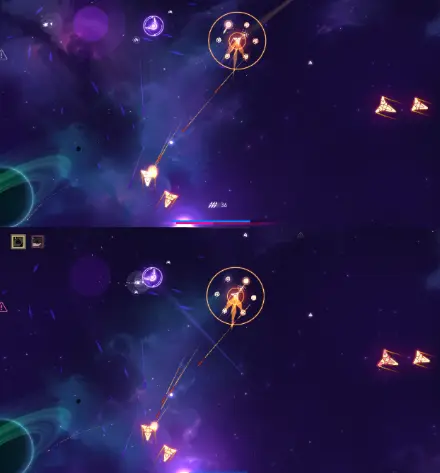
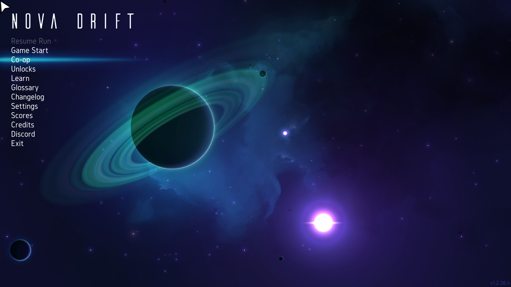
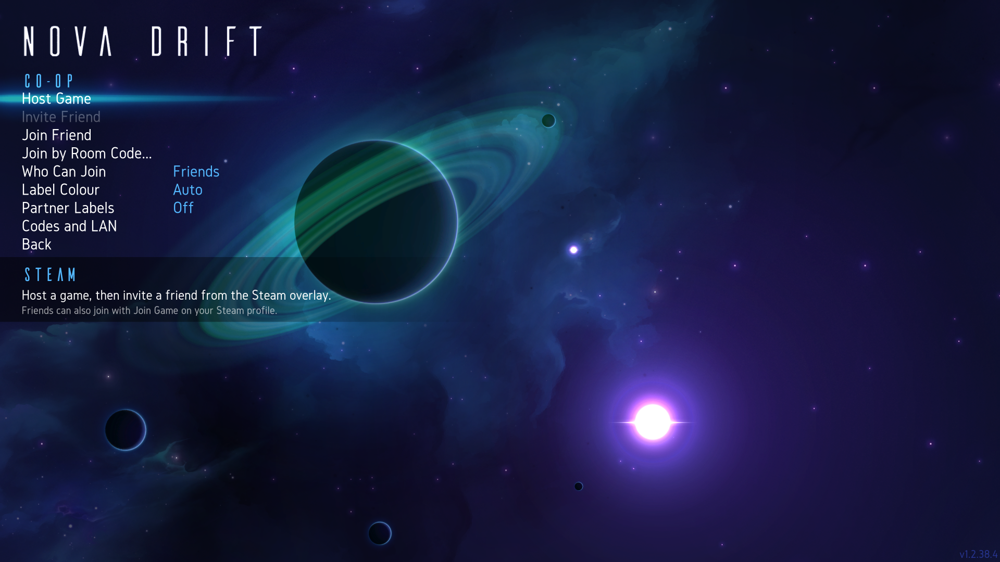
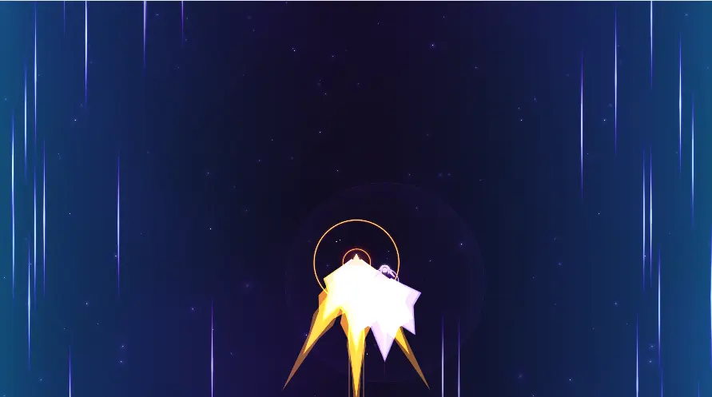

# NDML Co-op: two-player Nova Drift

A mod for [Nova Drift](https://store.steampowered.com/app/858210/Nova_Drift/) that lets two players play one run together, over Steam, over the internet with a room code, or via LAN. It runs on the [NDML](https://github.com/Yume-13/NDML) mod loader.

## Session rules

* **The host runs the world.** The host also chooses the session's difficulty and modifier settings.
* Either player pausing pauses both; play resumes when both have unpaused or the link, if lost, returns.
* **Experience moves in lockstep.** Both players earn an upgrade at the same time. Score is also shared.
* **Respawns.** As long as one player lives, the other will return to play 45 seconds after dying.
* **No saves.** Co-op runs are not saved and cannot be resumed.
* This mod disables uploading scores to the online leaderboard.

Both players need the same game build and the same release of this mod (over Steam the mod files themselves are compared).

The network protocol is hardened: it can repair from ping spikes, jitter, and link drops. If link is lost, the game pauses automatically after 15 seconds, and can wait indefinitely for a reconnection.

Please note, however: The game is fast paced and may have thousands of non-deterministic, fast moving objects on screen at any given time. **The bandwidth requirements are high for a multiplayer game**, and even with the protocol's recovery abilities, many objects may have spawned or died very quickly and thus jumps from network repairs can still be jarring.

## Install

Requires NDML 0.1.2 or newer. Both players install the mod.

1. Download NDML from [its releases](https://github.com/Yume-13/NDML/releases) and extract the zip anywhere (not into the game folder).
2. Download this mod from [its releases](https://github.com/Yume-13/NDML-Coop/releases) and put `ndmod_coop.dll` in the same folder as `ndml.exe`.
3. Run `ndml.exe` and press `I`. This installs the loader and every mod next to `ndml.exe` into the game folder (the mod goes to `Nova Drift/ndml/mods/`).
4. Press `G` to launch Nova Drift.

If NDML 0.1.2 or newer is already installed, you can instead copy `ndmod_coop.dll` straight into `Nova Drift/ndml/mods/`.

## Play

With Steam:

1. Both players start the game. The main menu has a new row, **Co-op**.
2. The host chooses **Co-op**, then **Host Game**. The page says "Lobby open. Invite a friend from the Steam overlay."
3. The host chooses **Invite Friend**, which opens the Steam overlay's invite list, and invites the other player.
4. The joining player accepts the invite in Steam, or chooses Join Game on the host's Steam profile. The page shows the version check, then "Linked with" and the host's name.
5. Both players go to the new game screen. The host picks the game modes and presses **Start**; the joining player's display follows the host's picks, and its Start row reads **Ready**: The game starts when both players are ready.

When you open **Codes and LAN**, the game asks two public STUN servers (`stun.l.google.com` and `stun.cloudflare.com`) for your internet address, and asks again from time to time while no link is up. The code you copy contains your public IP address and port. `internet_lookup = false` in the settings turns the lookup off; LAN and Steam play still work.

Only Steam mode supports the use of a relay if your connection requires it; however, this means all the game's network traffic moves under your account in Steam. Games such as Barotrauma use this natively, and games such as Noita access it via co-op mods; as such, we do not anticipate difficulties with Steam mode.

## License

MIT. See [LICENSE.md](LICENSE.md).

NDML Co-op is an unofficial, fan-made project. It is not affiliated with or endorsed by the developers of Nova Drift, and contains no game code or assets.

